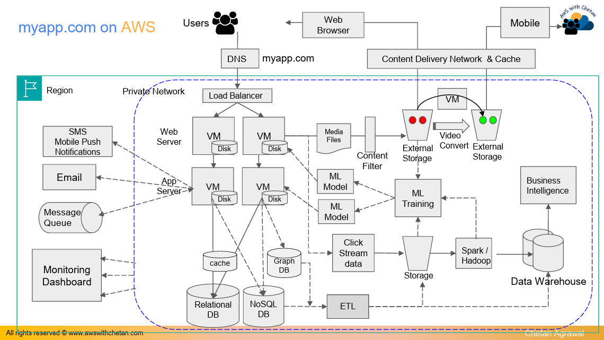
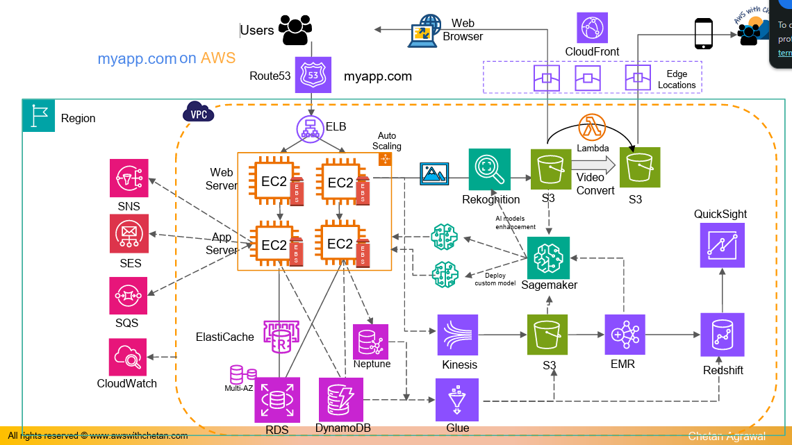

# 1 - AWS Cloud Overview - A Big Picture

## 1.1 - Cloud Computing and AWS Global Infrastructure

In the diagrams, the application runs in an AWS Region. Its components can span Availability Zones (AZs) so one AZ failure need not take the application offline. See [Cloud Concepts](./03%20-%20Cloud%20Concepts.md) and [AWS Global Infrastructure](./04%20-%20AWS%20Global%20Infrastructure.md) for definitions and placement decisions.

## 1.2 - Core Application Architecture Concepts

A production application usually contains multiple components rather than a single server.

### Multi-Tier Architecture

The example social media application separates functionality into:
- **Web tier** - handles incoming user requests and caching
- **Application tier** - performs business logic and communicates with databases
- **Data tier** - stores application data

As demand increases, additional web and application servers can be added. This is **horizontal scaling**.

### Load Balancing and DNS

When multiple web servers exist, a **load balancer** provides a common entry point and distributes incoming traffic between them.

A **DNS service** translates a domain name such as `myapp.com` into the address needed to reach the application.

### Storage Types

The architecture distinguishes between:
- **Block storage** - disks attached to virtual machines
- **Database storage** - structured application information
- **Object storage** - media such as images and videos that can be accessed independently over the network

The lecture uses object storage for uploaded media rather than storing large media files directly in the application database.

### Content Delivery Network

A **Content Delivery Network (CDN)** caches content closer to users.

This:
- Reduces latency.
- Avoids repeatedly retrieving the same content from the original storage
- Reduces load on the application's origin resources.

## 1.3 - Core AWS Serving Mapping

| **Application Requirement**  | **AWS Service**                  | **Main Purpose**                                         |
| ---------------------------- | -------------------------------- | -------------------------------------------------------- |
| Private network              | **Amazon VPC**                   | Provides an isolated network for AWS resources           |
| Virtual servers              | **Amazon EC2**                   | Runs virtual machines for web and application servers    |
| EC2 disk storage             | **Amazon EBS**                   | Provides block storage for EC2 instances                 |
| Relational database          | **Amazon RDS**                   | Managed relational database service                      |
| NoSQL database               | **Amazon DynamoDB**              | NoSQL database service                                   |
| Distribute traffic           | **Elastic Load Balancing (ELB)** | Distributes incoming traffic across servers              |
| Automatic horizontal scaling | **Amazon EC2 Auto Scaling**      | Adds or removes EC2 instances according to demand        |
| DNS                          | **Amazon Route 53**              | Maps domain names to application endpoints               |
| Object storage               | **Amazon S3**                    | Stores objects such as images, videos, and other files   |
| Serverless processing        | **AWS Lambda**                   | Runs code in response to events without managing servers |
| Content delivery             | **Amazon CloudFront**            | Caches and servers content through edge locations        |

These services map the traditional application components to managed AWS capabilities.

In this architecture, [EC2](./06%20-%20Foundation%20-%20Amazon%20EC2.md) hosts running application servers and [Lambda](./07%20-%20AWS%20Compute%20-%20Containers,%20ECS,%20EKS%20and%20Lambda.md) runs code in response to events. [EBS, EFS, and S3](./11%20-%20Foundation%20-%20AWS%20Storage%20Services.md) supply block, file, and object storage for different application needs.

## 1.4 - Messaging, Notifications, and Monitoring

A web tier can send work to **Amazon SQS** for a worker to process later, use **Amazon SNS** to notify subscribers, and use **Amazon SES** for application email. **Amazon CloudWatch** monitors metrics and can alarm when a threshold is breached. See [Application Integration](./14%20-%20AWS%20Application%20Integration%20Services.md) and [Monitoring and Logging](./17%20-%20AWS%20Monitoring%20and%20Logging.md).

## 1.5 - Data, Analytics, and Machine Learning

A streaming pipeline can use Kinesis Data Streams to collect events, Data Firehose to deliver them into S3, AWS Glue to catalog or transform the data, and Athena or Redshift to query it. A BI dashboard can visualize the results. The [analytics pipeline exercise](./13%20-%20AWS%20Big%20Data%20And%20Analytics%20Services.md) walks through these roles. For trained models and AI APIs, see [Machine Learning and AI](./18%20-%20Machine%20Learning%20and%20AI.md).

## 1.6 - Infrastructure as Code

Use [CloudFormation](./15%20-%20Infrastructure%20&%20Application%20Deployment%20%28DevOps%29.md) to deploy the components in a repeatable stack from a template.

## 1.7 - Exam Focus

- **On-demand IT resources + pay-as-you-go pricing - Cloud computing**
- **Geographic AWS deployment area - AWS Region**
- **High availability locations inside a Region - Availability Zones**
- **Private AWS network - Amazon VPC**
- **Virtual machine - Amazon EC2**
- **Persistent block storage for EC2 - Amazon EBS**
- **Managed relational database - Amazon RDS**
- **NoSQL database - Amazon DynamoDB**
- **Object storage - Amazon S3**
- **DNS - Amazon Route 53**
- **Distribute incoming traffic - Elastic Load Balancing**
- **Automatically add or remove EC2 capacity - Amazon EC2 Auto Scaling**
- **Serverless event-driven code - AWS Lambda**
- **CDN / edge caching - Amazon CloudFront**
- **Streaming data - Amazon Kinesis**
- **ETL - AWS Glue**
- **Big-data processing with Hadoop / Spark - Amazon EMR**
- **Data warehouse - Amazon Redshift**
- **Business intelligence - Amazon QuickSight**
- **Build custom ML models - Amazon SageMaker**
- **Analyze images and video - Amazon Rekognition**
- **Notifications - Amazon SNS**
- **Email - Amazon SES**
- **Message queues - Amazon SQS**
- **Monitoring - Amazon CloudWatch**
- **Infrastructure as Code - AWS CloudFormation**

## 1.8 - End-user computing and IoT

| Need                                                                                   | AWS service                                                                                                               |
| -------------------------------------------------------------------------------------- | ------------------------------------------------------------------------------------------------------------------------- |
| Give users cloud-hosted desktops                                                       | **Amazon WorkSpaces**                                                                                                     |
| Stream centrally hosted desktop apps to users                                          | **Amazon WorkSpaces Applications**, listed as **AppStream 2.0** in the exam guide                                         |
| Give users a managed browser session that isolates web content from their local device | **Amazon WorkSpaces Secure Browser**. Closed to new customers October 29, 2026. Existing customers can continue using it. |
| Connect devices securely and route telemetry to AWS services                           | **AWS IoT Core**. A fleet of sensors can publish readings for routing to downstream storage or processing.                |

[CLF-C02 Domain 3](https://docs.aws.amazon.com/aws-certification/latest/cloud-practitioner-02/cloud-practitioner-02-domain3.html) · [WorkSpaces Applications](https://aws.amazon.com/workspaces/applications/) · [Secure Browser availability](https://docs.aws.amazon.com/workspaces-web/latest/adminguide/workspaces-secure-browser-maintenance-mode.html) · [AWS IoT Core](https://docs.aws.amazon.com/iot/latest/developerguide/aws-iot-how-it-works.html)
